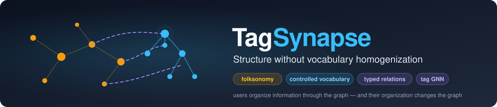
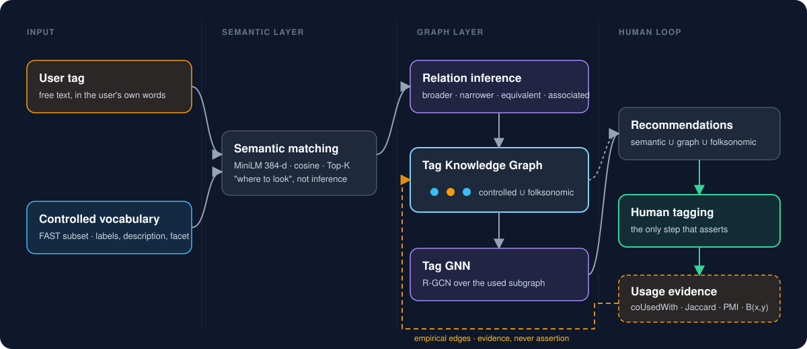
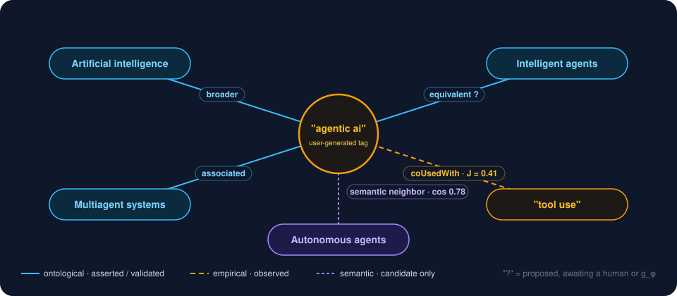
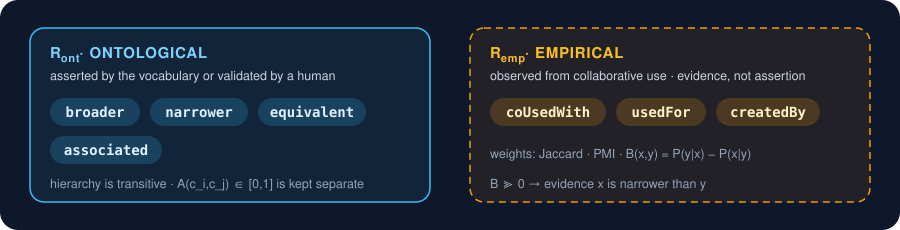
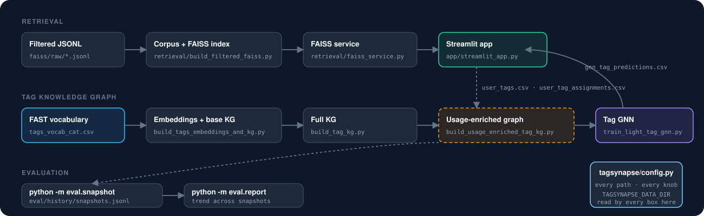
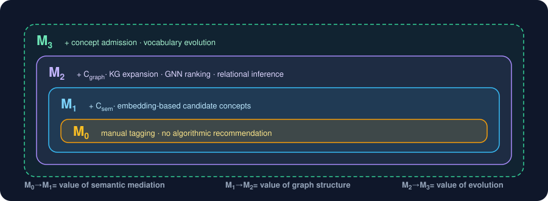

<p align="center">
  <picture>
    <source media="(prefers-color-scheme: dark)" srcset="docs/assets/banner-dark.svg">
    <source media="(prefers-color-scheme: light)" srcset="docs/assets/banner-light.svg">
    
  </picture>
</p>

<p align="center">
  <a href="LICENSE"></a>
  
  <a href="https://github.com/angjelinhila/tagsynapse/actions/workflows/tests.yml"></a>
  
</p>

<h3 align="center">A GNN-Mediated Collaborative Tagging Interface Bridging Folksonomies and Formal Ontologies</h3>

**TagSynapse** is a human-in-the-loop collaborative tagging system that connects free-form user tags with a controlled
vocabulary through semantic matching, a **Tag Knowledge Graph (TKG)**, and graph neural network recommendations. It
preserves the flexibility of folksonomic tagging while adding the structure, navigability, and retrieval advantages of
formal knowledge organization.

The full design lives in **[`docs/BLUEPRINT.md`](docs/BLUEPRINT.md)**; the formal model, every symbol and score, in
**[`docs/TAG_MODEL.md`](docs/TAG_MODEL.md)**; and what we measure — what's computable today vs. blocked on the
controlled study — in **[`docs/EVALUATION.md`](docs/EVALUATION.md)**. This README is the quickstart; those docs are
the "why."

---

## Overview

Traditional tagging systems tend to fall between two extremes:

- **folksonomies**, which preserve user language but fragment into overlapping or inconsistent tags;
- **controlled vocabularies**, which provide structure but constrain how users describe information.

TagSynapse bridges these. Users can freely create tags, reuse existing folksonomic tags, or adopt
controlled-vocabulary recommendations. Rather than replacing user language with canonical terminology, TagSynapse
represents both within a shared graph and learns relationships among them.

<p align="center"></p>

The architecture separates five forms of system intelligence — **semantic retrieval** (identifies plausible
concepts), **relation inference** (how concepts relate), **graph structural inference** (relational context),
**usage evidence** (collaborative tagging behaviour), and **human validation** (the only step that asserts). The
amber feedback path is what makes the graph evolve: every accepted annotation is an event, co-use becomes
`coUsedWith` edges, and asymmetric co-use becomes *evidence* for hierarchy that a human or the relation classifier
confirms — never written straight into the ontology.

---

## Design principle: relation-first, not canonicalization-first

A user-generated tag is not replaced because a similar controlled term exists. It remains a first-class node while
acquiring typed relationships to controlled and folksonomic concepts.

<p align="center"></p>

Three kinds of edge, deliberately kept apart because they are different kinds of evidence:

<p align="center"></p>

The usage statistics behind the empirical layer — co-use counts, Jaccard, PMI, and behavioural subsumption
`B(x,y) = P(y|x) − P(x|y)` — are implemented in [`tagsynapse/usage.py`](tagsynapse/usage.py) and documented in
[`TAG_MODEL.md`](docs/TAG_MODEL.md) §7 and §11.

---

## Repo layout

```
tagsynapse/
├── docs/
│   ├── BLUEPRINT.md          # full design doc: purpose, architecture, pipeline, research design
│   ├── TAG_MODEL.md          # formal model: every set, score and update rule
│   ├── EVALUATION.md         # what we measure, computable-now vs. study-dependent, snapshot history
│   └── assets/               # banners + figures (see assets/README.md for the palette)
├── tagsynapse/               # importable core - no streamlit / torch imports, unit-tested
│   ├── config.py             # every path and knob, env-overridable; one file, one glance
│   ├── relations.py          # R_ont / R_emp vocabulary + raw-relation bucketing
│   ├── usage.py              # co-use counts, Jaccard, PMI, behavioural subsumption
│   ├── text.py               # tokenisation shared by the lexical search paths
│   └── store.py              # read/write the runtime tagging CSVs
├── app/
│   └── streamlit_app.py      # the UI: search, tagging, KG expansion, analytics
├── retrieval/
│   ├── build_filtered_faiss.py   # JSONL -> corpus CSV + MiniLM FAISS index
│   └── faiss_service.py          # tiny Flask /search endpoint the app calls
├── tagging/
│   ├── build_tags_embeddings_and_kg.py  # controlled vocab -> embeddings + base KG edge index
│   ├── build_tag_kg.py                  # full KG: controlled + user tags + prop edges
│   ├── build_usage_enriched_tag_kg.py   # assignments -> coUsedWith / subsumption / used-node files
│   └── train_light_tag_gnn.py           # relational GNN over the used subgraph -> predictions
├── eval/
│   ├── metrics.py            # vocabulary-state metrics (live) + study-dependent stubs (raise)
│   ├── snapshot.py           # `python -m eval.snapshot` - records one vocabulary snapshot
│   ├── report.py             # `python -m eval.report`   - trend view across snapshots
│   └── history/              # snapshots.jsonl, created on first run; version-controlled on purpose
├── tests/                    # 29 unit tests; app smoke test skips without streamlit
├── docker/faiss.Dockerfile · docker-compose.yaml
├── .env.example · requirements.txt · LICENSE
```

<p align="center"></p>

---

## Quickstart

```bash
git clone https://github.com/angjelinhila/tagsynapse.git && cd tagsynapse
python3 -m venv venv && source venv/bin/activate
pip install -r requirements.txt
cp .env.example .env     # optional - defaults resolve to ./faiss/{index,tagging}

pytest                   # package + eval tests run anywhere; the app smoke
                         # test also runs if streamlit is installed, else skips
```

With data in place (next section):

```bash
docker compose up -d faiss-service              # /search on :5000, reads ./faiss/index
streamlit run app/streamlit_app.py

python tagging/build_usage_enriched_tag_kg.py   # refresh coUsedWith edges from what people tagged
python -m eval.snapshot --label pilot-1         # record where the vocabulary stands
python -m eval.report                           # how it has moved across snapshots
```

### Data

Generated corpora, FAISS indexes, embedding matrices, trained model artifacts, and live tagging data are not stored
in Git. The layout [`tagsynapse/config.py`](tagsynapse/config.py) expects:

```
faiss/
├── raw/        *_filtered_output.jsonl            <- input to retrieval/build_filtered_faiss.py
├── index/      <sub>_filtered_output_corpus.csv   <- built by build_filtered_faiss.py, read by the app
│               <sub>_filtered_output_faiss.index  <- read by faiss_service.py
└── tagging/    tags_vocab_cat.csv, tags_edges_cat.csv   <- FAST subset (input)
                tags_vocab_embeddings.npy, kg_*.csv      <- built by tagging/*.py
                user_tags.csv, user_tag_assignments.csv  <- written by the app as people tag
```

Set `TAGSYNAPSE_DATA_DIR` to put the whole tree somewhere else (a shared drive, a cluster allocation); every script
and the app follow it. Every other knob is listed in [`.env.example`](.env.example).

---

## Retrieval

The dense layer uses `sentence-transformers/all-MiniLM-L6-v2` (384-d) in a FAISS `IndexFlatIP` over L2-normalised
vectors, so inner product is cosine. The app also supports TF-IDF, BM25, Boolean, hybrid dense/lexical retrieval, and
tag- and graph-assisted browsing. Relational retrieval — expanding a query through the TKG and scoring documents by
tag compatibility — is specified in [`TAG_MODEL.md`](docs/TAG_MODEL.md) §20–22.

---

## Research design

TagSynapse supports cumulative assistance conditions, so each delta isolates one layer:

<p align="center"></p>

| Condition | Assistance | Isolates |
|---|---|---|
| **M0 · Manual** | no algorithmic recommendation | baseline |
| **M1 · Semantic** | embedding-based candidate concepts | value of semantic mediation |
| **M2 · TagSynapse** | + KG expansion, GNN ranking, relational inference | value of graph structure |
| **M3 · Evolving** | + concept admission / vocabulary evolution | value of adaptive evolution |

Evaluation examines tagging behaviour, vocabulary development, semantic quality, graph evolution, user experience, and
retrieval performance. Which of these are computable today from the tagging logs, which wait on the study, and how
snapshots are recorded over time, is all in **[`docs/EVALUATION.md`](docs/EVALUATION.md)**.

---

## Status

- [x] Streamlit app: semantic + BM25 + Boolean search, RAG context builder, analytics
- [x] Controlled-vocabulary suggestions with canonicalisation of typed labels
- [x] KG-mediated expansion by relation bucket; used-subgraph view with centrality
- [x] Light relational GNN over the used subgraph → `gnn_tag_predictions.csv`
- [x] Empirical layer: `coUsedWith` edges with Jaccard / PMI / behavioural subsumption
- [x] Vocabulary-state metrics + snapshot history (`eval/snapshot.py`, `eval/report.py`)
- [ ] Suggestion-shown logging in the app — unblocks `tag_acceptance_rate` per condition
- [ ] Controlled study with M0 / M1 / M2 conditions — unblocks every study-dependent metric
- [ ] Relation classifier `g_φ(f, c)` for new-tag placement (TAG_MODEL §10) — today placement is similarity-only
- [ ] Constraint checker `Q(f, r, c)` before any edge lands in the ontology (TAG_MODEL §13)

---

## Documentation

- **[Project Blueprint](docs/BLUEPRINT.md)** — conceptual architecture and system design
- **[Formal Tag Model](docs/TAG_MODEL.md)** — mathematical specification of the TKG, relation inference, graph
  learning, and retrieval model
- **[Evaluation Framework](docs/EVALUATION.md)** — metrics, tiers, and the snapshot-history mechanism

## Paper

**Introducing TagSynapse: A GNN-Mediated Collaborative Tagging Interface Bridging Folksonomies and Formal Ontologies**

Citation information will be added following publication.

## License

MIT — see [`LICENSE`](LICENSE).
