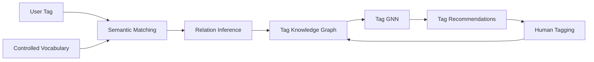

# TagSynapse

### A GNN-Mediated Collaborative Tagging Interface Bridging Folksonomies and Formal Ontologies

**TagSynapse** is a human-in-the-loop collaborative tagging system that connects free-form user tags with a controlled 
vocabulary through semantic matching, a **Tag Knowledge Graph (TKG)**, and graph neural network recommendations.

It is designed to preserve the flexibility of folksonomic tagging while adding the structure, navigability, and retrieval 
advantages of formal knowledge organization.

---

## Overview

Traditional tagging systems tend to fall between two extremes:

- **folksonomies**, which preserve user language but often fragment into overlapping or inconsistent tags;
- **controlled vocabularies**, which provide structure but constrain how users describe information.

TagSynapse bridges these approaches.

Users can freely create tags, reuse existing folksonomic tags, or adopt controlled-vocabulary recommendations. Rather 
than replacing user language with canonical terminology, TagSynapse represents both within a shared graph and learns 
relationships among them.

---

## Architecture



TagSynapse combines:

- **Folksonomic tagging** — users may freely create and reuse tags.
- **Controlled vocabulary** — a curated FAST-derived vocabulary provides stable semantic anchors.
- **Semantic matching** — MiniLM embeddings identify plausible related concepts.
- **Typed graph relations** — broader, narrower, equivalent, associative, and usage-derived relations remain distinct.
- **Graph learning** — a GNN incorporates graph structure into tag recommendation.
- **Hybrid retrieval** — dense, lexical, BM25, Boolean, and tag-assisted retrieval operate over the corpus.

---

## Design Principle

TagSynapse is **relation-first rather than canonicalization-first**.

A user-generated tag is not automatically replaced because a similar controlled term exists. Instead, the tag can remain 
a first-class node while acquiring relationships to controlled and folksonomic concepts.

```text
User-generated tag
        │
        ├── equivalent
        ├── broader / narrower
        ├── associated
        ├── semantic neighbor
        └── co-used with
```

This allows emergent language to remain visible while gaining structure from the surrounding knowledge graph.

---

## System Pipeline

### Retrieval

```text
Filtered corpus
      ↓
MiniLM embeddings
      ↓
FAISS index
      ↓
Retrieval service
      ↓
Streamlit interface
```

### Tag Knowledge Graph

```text
FAST controlled vocabulary
      ↓
Controlled-tag embeddings
      ↓
Base Tag Knowledge Graph
      +
User tags
      +
Tag assignments
      ↓
Usage-enriched graph
      ↓
Tag GNN
      ↓
Graph-mediated recommendations
```

---

## Repository Structure

```text
tagsynapse/
├── app/
│   └── streamlit_app.py
│
├── retrieval/
│   ├── build_filtered_faiss.py
│   └── faiss_service.py
│
├── tagging/
│   ├── build_tags_embeddings_and_kg.py
│   ├── build_tag_kg.py
│   ├── build_usage_enriched_tag_kg.py
│   └── train_light_tag_gnn.py
│
├── docker/
│   └── faiss.Dockerfile
│
├── docs/
│   ├── BLUEPRINT.md
│   └── TAG_MODEL.md
│
├── docker-compose.yaml
└── requirements.txt
```

---

## Retrieval

The dense retrieval layer uses:

```text
sentence-transformers/all-MiniLM-L6-v2
384-dimensional embeddings
FAISS IndexFlatIP
L2-normalized cosine retrieval
```

The application also supports:

- TF-IDF
- BM25
- Boolean retrieval
- hybrid dense/lexical retrieval
- tag- and graph-assisted browsing

---

## Tag Knowledge Graph

The TKG contains both controlled and user-generated concepts.

Relations may include:

```text
broader
narrower
equivalent
associated
coUsedWith
usedFor
```

The distinction between these relation types is important: semantic similarity, formal hierarchy, and collaborative 
co-use are different kinds of evidence.

---

## Research Design

TagSynapse supports comparison across three tagging conditions:

| Condition | Assistance |
|---|---|
| **Manual** | No algorithmic tag recommendation |
| **Semantic** | Embedding-based tag recommendation |
| **TagSynapse** | Embedding + TKG/GNN recommendation |

Evaluation can examine tagging behavior, vocabulary development, semantic quality, graph evolution, user experience, and 
retrieval performance.

---

## Documentation

- **[Project Blueprint](docs/BLUEPRINT.md)** — conceptual architecture and system design
- **[Formal Tag Model](docs/TAG_MODEL.md)** — mathematical specification of the TKG, relation inference, graph learning, 
and retrieval model

---

## Installation

```bash
git clone https://github.com/angjelinhila/tagsynapse.git
cd tagsynapse

python3 -m venv venv
source venv/bin/activate

pip install -r requirements.txt
```

Generated corpora, FAISS indexes, embedding matrices, trained model artifacts, and live tagging data are not stored in 
Git.

---

## Paper

**Introducing TagSynapse: A GNN-Mediated Collaborative Tagging Interface Bridging Folksonomies and Formal Ontologies**

Citation information will be added following publication.
