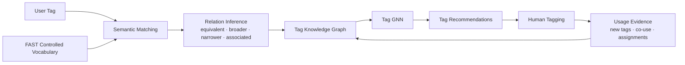

# TagSynapse: Project Blueprint

## 1. Purpose

TagSynapse is a collaborative knowledge-organization system that bridges **folksonomic tagging** and **formal 
ontologies**.

Folksonomies preserve the language and distinctions that emerge from users. Controlled vocabularies provide consistency, 
hierarchy, and navigability. TagSynapse treats these as complementary layers rather than forcing one to replace the 
other.

Its central design principle is:

> **Structure without vocabulary homogenization.**

User-generated tags remain first-class knowledge objects while semantic models, typed relations, graph structure, and 
learned recommendations connect them to a controlled vocabulary.

---

## 2. System Model

Let

\[
\mathcal C_t
\]

denote the controlled vocabulary at time \(t\), and

\[
\mathcal F_t
\]

the folksonomic vocabulary generated through use.

The Tag Knowledge Graph is

\[
\mathcal G_t=(V_t,E_t,\mathcal R)
\]

with

\[
V_t=\mathcal C_t\cup\mathcal F_t.
\]

Controlled and folksonomic concepts therefore coexist in the same graph while retaining distinct provenance.

---

## 3. Architecture



The system separates five forms of intelligence:

1. semantic retrieval;
2. relation inference;
3. graph structural inference;
4. collaborative usage evidence;
5. human validation.

No single component is expected to perform all five.

---

## 4. Semantic Candidate Generation

Dense representations identify plausible concepts.

For input \(x\) and controlled concept \(c\),

\[
s_{\mathrm{sem}}(x,c)
=
\cos(\mathbf x_x,\mathbf x_c)
\]

and candidate retrieval is

\[
C_{\mathrm{sem}}^{(k)}(x)
=
\operatorname{TopK}_{c\in\mathcal C_t}
s_{\mathrm{sem}}(x,c).
\]

This stage answers:

> **Where should the system look?**

It does not determine whether two concepts are equivalent, hierarchical, or merely associated.

The distinction is fundamental:

\[
\cos(\mathbf x_a,\mathbf x_b)
\not\Rightarrow
a\prec b
\]

and

\[
\cos(\mathbf x_a,\mathbf x_b)
\not\Rightarrow
a\equiv b.
\]

Semantic similarity generates candidates. Relation inference determines conceptual structure.

---

## 5. Tag Recommendation

For information object \(d\), TagSynapse can assemble recommendations from

\[
C(d)
=
C_{\mathrm{sem}}(d)
\cup
C_{\mathrm{graph}}(d)
\cup
C_{\mathrm{folk}}(d)
\]

where:

- \(C_{\mathrm{sem}}\) contains semantically retrieved controlled concepts;
- \(C_{\mathrm{graph}}\) contains graph-mediated recommendations;
- \(C_{\mathrm{folk}}\) contains previously established folksonomic tags.

The human selects

\[
T_d
\subseteq
C(d)\cup T_{\mathrm{new}}
\]

where \(T_{\mathrm{new}}\) contains freely created tags.

The human therefore remains the final annotation authority.

---

## 6. Relation Model

TagSynapse distinguishes **ontological relations** from **empirical relations**.

### Ontological relations

\[
\mathcal R_{\mathrm{ont}}
=
\{
\texttt{broader},
\texttt{narrower},
\texttt{equivalent},
\texttt{associated}
\}
\]

These describe conceptual organization.

### Empirical relations

\[
\mathcal R_{\mathrm{emp}}
=
\{
\texttt{coUsedWith},
\texttt{usedFor},
\texttt{createdBy}
\}
\]

These describe observed collaborative behavior.

Thus

\[
\texttt{coUsedWith}
\neq
\texttt{associated}.
\]

Behavioral association can provide evidence about conceptual structure without itself becoming an ontological assertion.

---

## 7. Folksonomy–Ontology Bridge

A new user-generated tag need not be immediately absorbed into the controlled vocabulary.

A candidate may become:

```text
existing concept
alternate label
folksonomic tag
new controlled concept
```

This permits novel vocabulary to persist while evidence accumulates.

The system can therefore preserve emergent terminology before deciding whether it should alter the formal ontology.

---

## 8. Usage Evidence

Each accepted tag assignment contributes empirical evidence.

For tag \(t\) and document \(d\),

\[
Y_{dt}
=
\begin{cases}
1 & \text{if tag }t\text{ is assigned to }d\\
0 & \text{otherwise}
\end{cases}
\]

Co-use count is

\[
N_{ij}
=
\sum_dY_{di}Y_{dj}.
\]

Such observations can generate empirical graph edges and later support richer measures such as normalized co-use, 
behavioral subsumption, persistence, and stabilization.

---

## 9. Graph Learning

Each tag begins with a semantic representation:

\[
\mathbf h_v^{(0)}
=
\mathbf x_v.
\]

Graph propagation produces a structure-aware representation:

\[
\mathbf h_v
=
\operatorname{GNN}
\left(
\mathbf x_v,\mathcal G_t
\right).
\]

The distinction is:

\[
\mathbf x_v
\]

captures textual semantics, while

\[
\mathbf h_v
\]

captures textual semantics conditioned on relational graph context.

Graph-mediated recommendations can therefore surface candidates not recoverable from embedding proximity alone.

---

## 10. Graph Evolution

Validated interactions update the graph:

\[
\mathcal G_{t+1}
=
\mathcal G_t
+
\Delta\mathcal G_t.
\]

The central feedback loop is:

\[
\boxed{
\mathcal G_t
\rightarrow
\text{recommendations}
\rightarrow
\text{human tagging}
\rightarrow
\text{validated knowledge}
\rightarrow
\mathcal G_{t+1}
}
\]

Users organize information through the graph, and their organization of information changes the graph.

---

## 11. Retrieval

TagSynapse complements the existing search architecture rather than replacing it.

The interface supports:

- dense FAISS retrieval;
- TF-IDF;
- BM25;
- Boolean retrieval;
- hybrid retrieval;
- tag- and graph-assisted browsing.

The dense index uses:

```text
sentence-transformers/all-MiniLM-L6-v2
384-dimensional embeddings
FAISS IndexFlatIP
L2-normalized cosine retrieval
```

Graph structure adds a second retrieval path through controlled concepts, folksonomic tags, hierarchical relations, and 
learned associations.

---

## 12. Implementation Pipeline

### Retrieval

```text
filtered information objects
        ↓
MiniLM embeddings
        ↓
FAISS index
        ↓
retrieval service
        ↓
Streamlit interface
```

### Tag Knowledge Graph

```text
FAST controlled vocabulary
        ↓
controlled-tag embeddings
        ↓
base Tag Knowledge Graph
        +
user tags
        +
tag assignments
        ↓
usage-enriched graph
        ↓
Tag GNN
        ↓
recommendations
```

Primary source files:

```text
app/
    streamlit_app.py

retrieval/
    build_filtered_faiss.py
    faiss_service.py

tagging/
    build_tags_embeddings_and_kg.py
    build_tag_kg.py
    build_usage_enriched_tag_kg.py
    train_light_tag_gnn.py
```

---

## 13. Research Design

TagSynapse supports three assistance conditions:

\[
M_0
=
\text{manual tagging}
\]

\[
M_1
=
M_0
+
C_{\mathrm{sem}}
\]

\[
M_2
=
M_1
+
C_{\mathrm{graph}}
\]

corresponding to:

1. manual tagging;
2. embedding-based semantic recommendation;
3. embedding + TKG/GNN-based recommendation.

This separates the value of semantic mediation from the additional contribution of graph structure.

Evaluation can examine:

- tag acceptance;
- custom tag creation;
- semantic alignment;
- vocabulary growth;
- new graph relations;
- usefulness;
- trust;
- perceived control;
- retrieval precision and recall;
- ranking quality;
- semantic relevance.

---

## 14. Core Design Principle

TagSynapse is built around a simple proposition:

> **Users should not have to surrender their vocabulary in order to benefit from structured knowledge organization.**

Controlled concepts provide stability.

Folksonomic tags preserve emergent language.

Semantic models connect nearby concepts.

Graph structure captures relational context.

Collaborative use changes the graph.

Together, these provide a path toward adaptive, human-in-the-loop knowledge organization.
