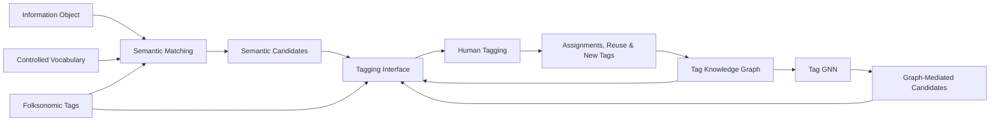
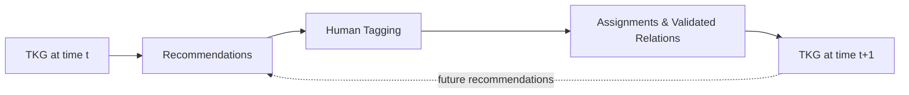

# TagSynapse: Project Blueprint

**TagSynapse** is a human-in-the-loop collaborative tagging system that connects open folksonomic vocabulary with a controlled vocabulary through semantic representations, a **Tag Knowledge Graph (TKG)**, graph learning, and collaborative use.

For the full mathematical specification, see [TAG_MODEL.md](TAG_MODEL.md).

---

## 1. Design Goal

TagSynapse addresses a fundamental tension in collaborative knowledge organization:

- **folksonomies** preserve the language users actually use, but can fragment into overlapping or weakly organized tags;
- **controlled vocabularies** provide consistency and hierarchy, but can constrain emergent terminology.

TagSynapse treats these as complementary layers.

> **The goal is structure without vocabulary homogenization.**

User-generated tags remain first-class knowledge objects. Controlled concepts provide stable anchors. Semantic models identify plausible relationships. Graph structure captures relational context. Collaborative use supplies additional evidence.

---

## 2. Core Representation

TagSynapse maintains a controlled vocabulary and a folksonomic vocabulary within a shared graph.

```math
\mathcal{G}_t = (V_t,E_t,\mathcal{R})
```

with:

```math
V_t = \mathcal{C}_t \cup \mathcal{F}_t
```

where:

- `C_t` is the controlled vocabulary at time `t`;
- `F_t` is the folksonomic vocabulary generated through use;
- `R` is the set of typed relations.

A folksonomic tag can participate in the TKG without becoming a controlled concept.

---

## 3. System Architecture



The architecture separates five forms of evidence:

1. **Semantic evidence** identifies plausible concepts.
2. **Ontological evidence** captures formal conceptual relationships.
3. **Graph evidence** captures relational structure.
4. **Usage evidence** captures collaborative behavior.
5. **Human decisions** determine the final annotations and contribute new evidence.

No single model is responsible for all five.

---

## 4. Relation-First Organization

TagSynapse is **relation-first rather than canonicalization-first**.

A new user tag is not automatically replaced because a similar controlled term exists. Instead, it can remain available while acquiring relationships to controlled or folksonomic concepts.

```text
user-generated tag
        │
        ├── equivalent
        ├── broader
        ├── narrower
        ├── associated
        ├── semantic neighbor
        └── co-used with
```

This makes **origin** and **status** distinct.

A concept may originate as a user-generated tag and later become structurally stable through reuse, semantic coherence, graph position, or formal integration.

---

## 5. Relation Model

TagSynapse distinguishes formal conceptual structure from observed collaborative behavior.

### Ontological relations

| Relation | Meaning |
|---|---|
| `broader` | The target is conceptually broader |
| `narrower` | The target is conceptually narrower |
| `equivalent` | Two labels denote the same concept |
| `associated` | Non-hierarchical conceptual association |

### Empirical relations

| Relation | Meaning |
|---|---|
| `coUsedWith` | Tags are assigned together |
| `usedFor` | A tag is assigned to an information object |
| `createdBy` | Provenance relation to a user |

The relation space is therefore:

```math
\mathcal{R}
=
\mathcal{R}_{\mathrm{ont}}
\cup
\mathcal{R}_{\mathrm{emp}}
```

Observed co-use can provide evidence about conceptual structure without itself becoming an ontological assertion.

---

## 6. Semantic Candidate Generation

Dense semantic representations identify concepts worth considering.

For input `x` and concept `c`:

```math
s_{\mathrm{sem}}(x,c)
=
\cos(\mathbf{x}_x,\mathbf{x}_c)
```

The top semantic candidates are:

```math
C_{\mathrm{sem}}^{(k)}(x)
=
\operatorname{TopK}_{c \in \mathcal{C}_t}
s_{\mathrm{sem}}(x,c)
```

Semantic retrieval answers:

> **Which concepts should the system consider?**

It does not establish hierarchy or equivalence.

```math
\cos(\mathbf{x}_a,\mathbf{x}_b)
\not\Rightarrow
a \prec b
```

Likewise:

```math
\cos(\mathbf{x}_a,\mathbf{x}_b)
\not\Rightarrow
a \equiv b
```

Semantic similarity therefore supports **candidate generation**. Typed relation inference and graph evidence determine conceptual structure.

---

## 7. Tag Recommendation

For information object `d`, TagSynapse can combine three recommendation sources:

```math
C(d)
=
C_{\mathrm{sem}}(d)
\cup
C_{\mathrm{graph}}(d)
\cup
C_{\mathrm{folk}}(d)
```

where:

- `C_sem(d)` contains semantic candidates;
- `C_graph(d)` contains graph-mediated candidates;
- `C_folk(d)` contains established folksonomic tags.

The user selects from these candidates or creates a new tag:

```math
T_d
\subseteq
C(d)
\cup
T_{\mathrm{new}}
```

Human tagging remains the final annotation authority.

---

## 8. Usage-Enriched Graph

Each accepted tag assignment contributes evidence about how the vocabulary is used.

Define assignment incidence:

```math
Y_{dt}
=
\begin{cases}
1 & \text{if tag } t \text{ is assigned to object } d \\
0 & \text{otherwise}
\end{cases}
```

Tag co-use is:

```math
N_{ij}
=
\sum_d
Y_{di}Y_{dj}
```

Usage evidence can support:

- tag reuse;
- co-occurrence;
- contextual coherence;
- behavioral subsumption;
- centrality;
- bridge structure;
- temporal persistence.

The usage layer enriches the TKG without collapsing behavioral association into ontology.

---

## 9. Graph Learning

Each tag begins with a semantic representation.

The graph model produces a representation conditioned on relational context:

```math
\mathbf{h}_v
=
\operatorname{GNN}
\left(
\mathbf{x}_v,
\mathcal{G}_t
\right)
```

The distinction is:

- `x_v` captures textual semantics;
- `h_v` captures textual semantics conditioned on graph structure.

The current lightweight GNN uses this graph context to predict plausible controlled-vocabulary anchors for folksonomic tags. The formal model generalizes this mechanism to typed relation prediction.

---

## 10. Folksonomy–Ontology Bridge

A new tag is not limited to a binary **accept / reject** outcome.

A tag may function as:

```text
existing concept
alternate label
folksonomic tag
new controlled concept
```

Folksonomic persistence is therefore a legitimate state.

This allows emergent terminology to remain useful while evidence accumulates about its meaning, reuse, semantic coherence, and graph position.

---

## 11. Graph Evolution

Validated interaction contributes a graph update:

```math
\mathcal{G}_{t+1}
=
\mathcal{G}_t
+
\Delta \mathcal{G}_t
```

The feedback loop is:



Conceptually:

> **Users organize information through the graph, and their organization of information changes the graph.**

---

## 12. Retrieval

TagSynapse extends the existing search architecture rather than replacing it.

### Textual retrieval

The application supports:

- dense FAISS retrieval;
- TF-IDF;
- BM25;
- Boolean retrieval;
- hybrid dense/lexical retrieval.

### Relational retrieval

The tag graph introduces additional retrieval paths through:

- exact tag assignment;
- hierarchical relationships;
- semantic neighborhoods;
- empirical co-use;
- graph-mediated relationships.

The dense retrieval layer uses:

- `sentence-transformers/all-MiniLM-L6-v2`;
- 384-dimensional embeddings;
- `FAISS IndexFlatIP`;
- L2 normalization so inner product corresponds to cosine similarity.

---

## 13. Implementation Pipeline

### Retrieval pipeline

```text
filtered information objects
        ↓
MiniLM embeddings
        ↓
FAISS index
        ↓
FAISS service
        ↓
Streamlit interface
```

### Tagging pipeline

```text
FAST-derived controlled vocabulary
        ↓
controlled-tag embeddings
        ↓
base Tag Knowledge Graph
        +
user tags
        +
tag assignments
        ↓
usage-enriched graph
        ↓
Tag GNN
        ↓
graph-mediated recommendations
```

### Core source files

| File | Role |
|---|---|
| `app/streamlit_app.py` | Interactive retrieval, tagging, and graph interface |
| `retrieval/build_filtered_faiss.py` | Builds MiniLM proposition corpora and FAISS indexes |
| `retrieval/faiss_service.py` | Serves dense FAISS retrieval |
| `tagging/build_tags_embeddings_and_kg.py` | Embeds the controlled vocabulary and indexes its relations |
| `tagging/build_tag_kg.py` | Builds the base Tag Knowledge Graph |
| `tagging/build_usage_enriched_tag_kg.py` | Adds usage, semantic, co-occurrence, and structural information |
| `tagging/train_light_tag_gnn.py` | Learns graph-mediated controlled-tag anchor predictions |

---

## 14. Experimental Model

The architecture supports three principal tagging conditions.

| Model | Assistance |
|---|---|
| `M0` | Manual tagging |
| `M1` | Manual tagging + semantic recommendation |
| `M2` | Semantic recommendation + TKG/GNN mediation |

Formally:

```math
M_0
=
\text{manual tagging}
```

```math
M_1
=
M_0
+
C_{\mathrm{sem}}
```

```math
M_2
=
M_1
+
C_{\mathrm{graph}}
```

This separates the contribution of semantic mediation from the additional contribution of graph structure.

---

## 15. Guiding Principle

TagSynapse treats formal organization and emergent vocabulary as mutually informative rather than mutually exclusive.

**Controlled concepts provide stability.**  
**Folksonomic tags preserve emergent language.**  
**Semantic representations identify plausible concepts.**  
**Graph structure supplies relational context.**  
**Collaborative use contributes new evidence.**  
**Human decisions govern the tagging process.**

Together, these components form an adaptive, human-in-the-loop knowledge-organization system.
