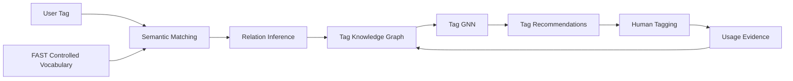

# TagSynapse: Project Blueprint

## 1. Purpose

TagSynapse is a collaborative knowledge-organization system that bridges **folksonomic tagging** and **formal 
ontologies**.

Folksonomies preserve the language and conceptual distinctions that emerge from users. Controlled vocabularies provide 
consistency, hierarchy, and navigability. TagSynapse treats these as complementary layers rather than forcing one to 
replace the other.

Its central design principle is:

> **Structure without vocabulary homogenization.**

User-generated tags remain first-class knowledge objects while semantic models, typed relations, graph structure, usage 
evidence, and learned recommendations connect them to a controlled vocabulary.

---

## 2. System Architecture



The architecture separates five forms of system intelligence:

1. **semantic retrieval** — identifies plausible concepts;
2. **relation inference** — determines how concepts are related;
3. **graph structural inference** — uses relational context;
4. **usage evidence** — learns from collaborative tagging behavior;
5. **human validation** — determines final annotations and uncertain graph updates.

---

## 3. Core Representation

Let:

- $\mathcal{C}_t$ denote the controlled vocabulary at time $t$;
- $\mathcal{F}_t$ denote the folksonomic vocabulary generated through use.

The Tag Knowledge Graph is:

$$
\mathcal{G}_t = (V_t, E_t, \mathcal{R})
$$

with:

$$
V_t = \mathcal{C}_t \cup \mathcal{F}_t
$$

Controlled and folksonomic concepts therefore coexist within the same graph while retaining distinct provenance.

A folksonomic tag does not need to become a controlled concept in order to participate in the graph.

---

## 4. Relation Model

TagSynapse distinguishes between **ontological relations** and **empirical relations**.

### Ontological relations

These describe conceptual organization:

```text
broader
narrower
equivalent
associated
```

### Empirical relations

These describe observed collaborative behavior:

```text
coUsedWith
usedFor
createdBy
```

This distinction is deliberate.

A pair of tags may frequently co-occur without one being ontologically broader, narrower, or formally associated with the 
other.

---

## 5. Semantic Candidate Generation

Dense semantic representations are used to identify plausible candidate concepts.

For input $x$ and concept $c$:

$$
s_{\mathrm{sem}}(x,c)
=
\cos(\mathbf{x}_x,\mathbf{x}_c)
$$

The top-$k$ semantic candidate set is:

$$
C_{\mathrm{sem}}^{(k)}(x)
=
\operatorname{TopK}_{c \in \mathcal{C}_t}
s_{\mathrm{sem}}(x,c)
$$

Semantic retrieval therefore answers:

> **Which concepts should the system consider?**

It does not determine hierarchy or equivalence.

In particular:

$$
\cos(\mathbf{x}_a,\mathbf{x}_b)
\not\Rightarrow
a \prec b
$$

and:

$$
\cos(\mathbf{x}_a,\mathbf{x}_b)
\not\Rightarrow
a \equiv b
$$

Semantic similarity generates candidates. Relational inference determines conceptual structure.

---

## 6. Tag Recommendation

For information object $d$, TagSynapse can draw recommendations from three sources:

$$
C(d)
=
C_{\mathrm{sem}}(d)
\cup
C_{\mathrm{graph}}(d)
\cup
C_{\mathrm{folk}}(d)
$$

where:

- $C_{\mathrm{sem}}$ contains semantically retrieved controlled concepts;
- $C_{\mathrm{graph}}$ contains graph-mediated recommendations;
- $C_{\mathrm{folk}}$ contains previously established folksonomic tags.

The user selects:

$$
T_d
\subseteq
C(d) \cup T_{\mathrm{new}}
$$

where $T_{\mathrm{new}}$ contains freely created tags.

Human tagging remains the final annotation authority.

---

## 7. Folksonomy–Ontology Bridge

A new user-generated tag is not restricted to a binary choice between acceptance into the ontology and rejection.

A tag may function as:

```text
existing concept
alternate label
folksonomic tag
new controlled concept
```

This allows novel vocabulary to remain useful while evidence about its meaning, usage, and graph position accumulates.

The system therefore treats folksonomic persistence as a legitimate state rather than an error condition.

---

## 8. Usage-Enriched Structure

Each accepted tag assignment contributes evidence about how the vocabulary is actually used.

For tag $t$ and document $d$:

$$
Y_{dt}
=
\begin{cases}
1 & \text{if tag } t \text{ is assigned to } d \\
0 & \text{otherwise}
\end{cases}
$$

Tag co-use count is:

$$
N_{ij}
=
\sum_d Y_{di}Y_{dj}
$$

These observations can generate empirical graph edges and support measures of:

- reuse;
- co-occurrence;
- persistence;
- semantic coherence;
- structural centrality;
- bridging between graph regions.

---

## 9. Graph Learning

Each tag begins with a semantic representation $\mathbf{x}_v$.

The GNN transforms these into graph-conditioned representations:

$$
\mathbf{h}_v
=
\operatorname{GNN}
(
\mathbf{x}_v,
\mathcal{G}_t
)
$$

The distinction is:

- $\mathbf{x}_v$ captures textual semantics;
- $\mathbf{h}_v$ captures textual semantics conditioned on graph structure.

This allows graph-mediated recommendation to surface relationships that embedding similarity alone may not reveal.

---

## 10. Graph Evolution

Validated tagging activity updates the graph:

$$
\mathcal{G}_{t+1}
=
\mathcal{G}_t
+
\Delta\mathcal{G}_t
$$

The central feedback loop is:

```text
Tag Knowledge Graph
        ↓
Recommendations
        ↓
Human Tagging
        ↓
Validated Usage and Relations
        ↓
Updated Tag Knowledge Graph
```

Conceptually:

> **Users organize information through the graph, and their organization of information changes the graph.**

---

## 11. Retrieval

TagSynapse complements the underlying search system rather than replacing it.

The interface supports:

- dense FAISS retrieval;
- TF-IDF;
- BM25;
- Boolean retrieval;
- hybrid retrieval;
- tag-assisted browsing;
- graph-mediated retrieval.

The dense retrieval index uses:

```text
sentence-transformers/all-MiniLM-L6-v2
384-dimensional embeddings
FAISS IndexFlatIP
L2-normalized cosine retrieval
```

Graph structure adds a relational retrieval layer through controlled concepts, folksonomic tags, hierarchical links, and 
learned associations.

---

## 12. Implementation Pipeline

### Retrieval pipeline

```text
Filtered information objects
        ↓
MiniLM embeddings
        ↓
FAISS index
        ↓
FAISS service
        ↓
Streamlit interface
```

### Tagging pipeline

```text
FAST controlled vocabulary
        ↓
Controlled-tag embeddings
        ↓
Base Tag Knowledge Graph
        +
User tags
        +
Tag assignments
        ↓
Usage-enriched graph
        ↓
Tag GNN
        ↓
Tag recommendations
```

Primary source files:

```text
app/
    streamlit_app.py

retrieval/
    build_filtered_faiss.py
    faiss_service.py

tagging/
    build_tags_embeddings_and_kg.py
    build_tag_kg.py
    build_usage_enriched_tag_kg.py
    train_light_tag_gnn.py
```

---

## 13. Experimental Model

TagSynapse supports three principal assistance conditions.

### Manual tagging

$$
M_0 = \text{manual tagging}
$$

### Semantic mediation

$$
M_1 = M_0 + C_{\mathrm{sem}}
$$

### Structural-semantic recommendation

$$
M_2 = M_1 + C_{\mathrm{graph}}
$$

This isolates:

- the contribution of semantic recommendation;
- the additional contribution of graph-mediated recommendation.

Evaluation can examine:

- tag acceptance;
- custom tag creation;
- semantic alignment;
- vocabulary growth;
- graph evolution;
- perceived usefulness;
- trust;
- user control;
- retrieval quality.

---

## 14. Guiding Principle

TagSynapse is built around a simple proposition:

> **Users should not have to surrender their vocabulary in order to benefit from structured knowledge organization.**

Controlled concepts provide stability.

Folksonomic tags preserve emergent language.

Semantic models connect nearby concepts.

Graph structure provides relational context.

Collaborative use changes the graph.

Together, these layers support adaptive, human-in-the-loop knowledge organization.

