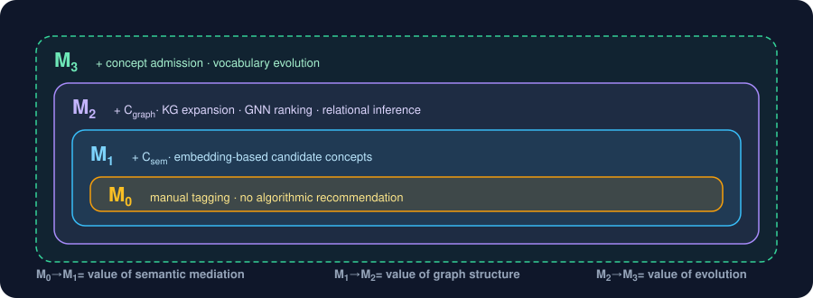

# Evaluation Framework

**Status:** Living document — expect this to grow as the controlled study runs and study-dependent metrics come online.
**Last updated:** November 2026

This is the full breakdown of what we measure, why, and what's actually computable today vs. blocked on the controlled study. `BLUEPRINT.md` §14 has the one-paragraph summary; `TAG_MODEL.md` §23 defines the ablation conditions; this is the detail that changes fastest.

---

## 1. What the system records at each stage

| Stage | Input | Output on disk | What kind of claim is this? |
|---|---|---|---|
| Semantic candidates | document or typed label | — (in-memory) | "Where to look" — candidate generation, not inference |
| Canonicalisation | typed label | `tag_canonicalization_events.csv` | "This string probably names an existing concept" |
| Human tagging | candidates ∪ free text | `user_tags.csv`, `user_tag_assignments.csv` | The only *validated* claim in the loop |
| Usage enrichment | assignments | `tag_cooccurrence_edges.csv`, `used_tag_*.csv` | "These were used together" — evidence, never assertion |
| GNN | used subgraph | `gnn_tag_predictions.csv` | "Given the graph, these are likely related" |

Everything downstream of the human row is derived. That ordering is the whole design: the empirical layer (R_emp) and the model layer may *propose*, only the human row *asserts*.

---

## 2. Task decomposition

<p align="center"></p>

End-to-end success is *better retrieval over a vocabulary that users actually recognise as their own*, but we score the sub-tasks separately because end-to-end numbers alone can't say which layer helped or hurt:

- **Semantic mediation** (M0 → M1) — do embedding-based suggestions get accepted, and do they reduce redundant near-duplicate tags?
- **Graph structure** (M1 → M2) — do KG-expanded and GNN-ranked suggestions change what people pick beyond what similarity alone would?
- **Vocabulary evolution** (M2 → M3) — does admitting folksonomic tags as concepts (TAG_MODEL §16) improve coverage without homogenising the vocabulary?
- **Retrieval** — does relational retrieval (TAG_MODEL §20–22) beat text-only retrieval on the same queries?

---

## 3. Evaluation tiers

### Tier 1 — computable now, from the tagging CSVs alone

These run on every `python -m eval.snapshot`. No study, no judge, no gold labels.

| Metric | What it checks | Where |
|---|---|---|
| `controlled_vocab_coverage` | Fraction of assignments that are controlled concepts. Should neither be forced to 1 nor allowed to hit 0 | `eval/metrics.py` |
| `custom_tag_rate` | 1 − coverage; BLUEPRINT §14's "custom tag creation" | `eval/metrics.py` |
| `tags_per_doc` | Mean \|T_d\| | `eval/metrics.py` |
| `vocabulary_size` | \|F_t\| — folksonomy growth over time | `eval/metrics.py` |
| `hierarchy_depth_stats` | How much user-asserted hierarchy exists; cycles are *reported*, not followed | `eval/metrics.py` |
| `couse_graph_stats` | Size of the `coUsedWith` graph, mean Jaccard, and how many pairs clear the behavioral-subsumption threshold — i.e. how much *directional* hierarchy evidence usage has produced | `tagsynapse/usage.py` |
| `canonicalization_rate` | Share of typed labels mapped to an existing concept (TAG_MODEL §15's alternate-label branch) | `eval/metrics.py` |

### Tier 2 — need the controlled study (M0 / M1 / M2)

| Metric | What it checks | Blocked on |
|---|---|---|
| `tag_acceptance_rate` | % of *shown* suggestions accepted, per condition | The app logging suggestions shown, not just tags saved — today only the numerator exists |
| `semantic_alignment` | Cosine between chosen tags and curator gold tags | Gold labels for a document sample |
| New-relation yield | Validated relations per 100 tagging events, per condition | Study + a validation UI |
| Usefulness / trust / perceived control | Post-task Likert | Survey instrument |

Stubs in `eval/metrics.py` raise `NotImplementedError` rather than return a fake number.

### Tier 3 — need relevance judgments

| Metric | What it checks | Blocked on |
|---|---|---|
| `retrieval_precision_recall` | P@k / R@k for text-only vs. relational retrieval | Per-query relevance judgments |
| Ranking quality (nDCG) | Same, graded | Same |

**The catch for Tier 2/3:** an LLM judge can't stand in for the user here. Whether a tag is "right" for a Reddit proposition is exactly the kind of contested, community-specific judgment TagSynapse exists to preserve rather than normalise. Human relevance judgments, from people who use the corpus, or nothing.

---

## 4. The attribution problem

Four layers cooperate on every suggestion list: encoder, KG expansion, GNN ranking, canonicalisation. A good end-to-end acceptance rate can't say which one earned it, and a bad one can't say which one broke. Two things keep this tractable:

1. **Conditions are cumulative by construction** (M0 ⊂ M1 ⊂ M2 ⊂ M3, TAG_MODEL §23), so each delta isolates one layer.
2. **Empirical edges are kept in separate files from ontological ones**, so a shift in `couse_graph_stats` can't be confused with a shift in the controlled vocabulary.

What we still can't separate today: whether a user accepted a suggestion *because* of KG expansion or despite it. That needs the suggestion-shown log (Tier 2, first row).

---

## 5. Snapshot history mechanism

Every `python -m eval.snapshot` appends one JSON line to `eval/history/snapshots.jsonl`. The file is version-controlled on purpose: "did that change to KG expansion shift how people tag?" is a question about this file's git history.

### Snapshot schema

```json
{
  "snapshot_id": "a1b2c3d4",
  "timestamp": "2026-11-01T18:00:00+00:00",
  "label": "pilot-1",
  "config": { "data_dir": "...", "embedding_model": "...", "faiss_api_url": "...", "seed": 42 },
  "counts": { "n_controlled_concepts": 0, "n_user_tags": 0, "n_assignments": 0, "n_tagged_docs": 0 },
  "vocabulary_metrics": {
    "controlled_vocab_coverage": 0.0, "custom_tag_rate": 0.0, "tags_per_doc": 0.0,
    "canonicalization_rate": 0.0,
    "n_with_parent": 0, "max_depth": 0, "n_cycles": 0,
    "n_couse_edges": 0, "mean_jaccard": 0.0, "n_subsumption_candidates": 0
  },
  "study_metrics": {}
}
```

`config` is recorded so a metric change is never ambiguous about its cause (did the KG expansion change, or did someone swap the encoder?). `label` lets study conditions share one file and be filtered apart with `python -m eval.report <label>`. `study_metrics` is present and empty until Tier 2 exists.

### Reading trends

```bash
python -m eval.report            # every snapshot, one row each, first → latest deltas
python -m eval.report pilot-1    # one condition
```

---

## 6. Known limitations in the metrics themselves

- **No timestamps on assignments.** `user_tag_assignments.csv` doesn't record when a tag was added, so vocabulary growth is only observable *between snapshots*, not within one. Adding a timestamp column is cheap and should happen before the study.
- **Behavioral subsumption is lexical-pair-level.** `B(x,y)` says nothing about *why* two tags co-occur. A high-|B| pair is a proposal for the relation classifier or a human, never an edge (TAG_MODEL §11 says "evidence rather than proof" and the code enforces that by writing candidates to their own output).
- **`canonicalization_rate` is a lower bound.** Its denominator is total assignments, including ones picked straight from the suggestion list that never went through canonicalisation.
- **Coverage treats all controlled concepts alike.** A document tagged with one very broad FAST heading counts the same as one tagged with a precise one. Depth-weighted coverage is a reasonable next step once hierarchy depth is reliably populated.

---

## 7. Status table

| Item | Status |
|---|---|
| Tier 1 metrics live on every snapshot | ✅ |
| Snapshot history + trend report | ✅ |
| `coUsedWith` edges with Jaccard / PMI / subsumption | ✅ `tagsynapse/usage.py`, `tagging/build_usage_enriched_tag_kg.py` |
| Suggestion-shown logging in the app | ⏳ unblocks `tag_acceptance_rate` |
| Assignment timestamps | ⏳ unblocks within-snapshot growth curves |
| M0 / M1 / M2 conditions in the UI | ⏳ unblocks all of Tier 2 |
| Relevance judgments for a query set | ⏳ unblocks Tier 3 |

---

## 8. References

- Golder, S. A., & Huberman, B. A. (2006). Usage patterns of collaborative tagging systems. *Journal of Information Science*, 32(2). — the co-use → structure argument behind §7/§11 of the model.
- Heymann, P., & Garcia-Molina, H. (2006). Collaborative creation of communal hierarchical taxonomies in social tagging systems. Stanford InfoLab TR. — centrality-driven hierarchy induction; the origin of treating asymmetric co-occurrence as directional evidence.
- Schlichtkrull, M., et al. (2018). Modeling relational data with graph convolutional networks. *ESWC*. — the R-GCN message-passing form in TAG_MODEL §8.
- OCLC FAST (Faceted Application of Subject Terminology). — the controlled vocabulary.
